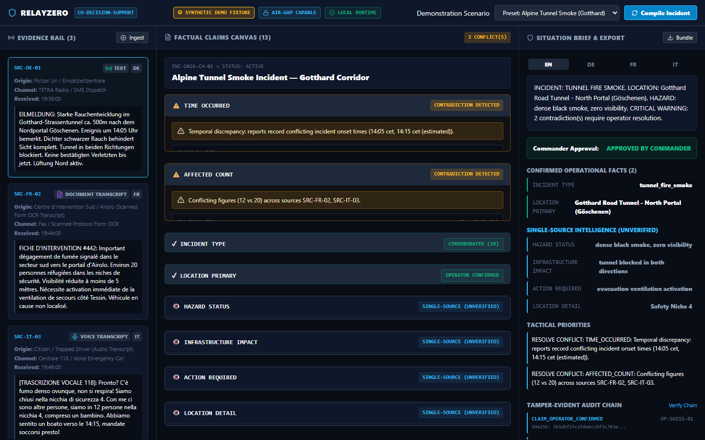
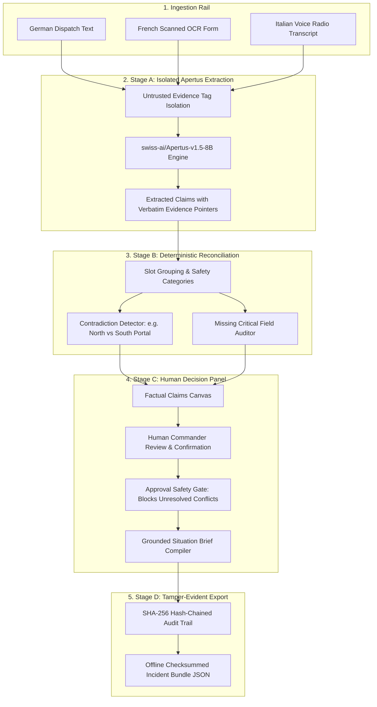
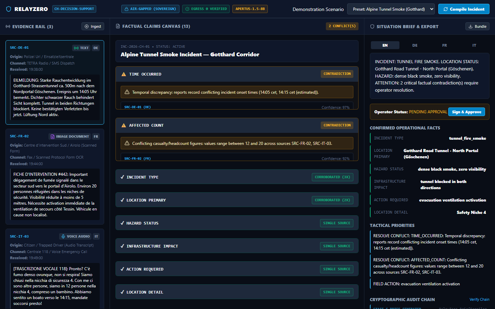
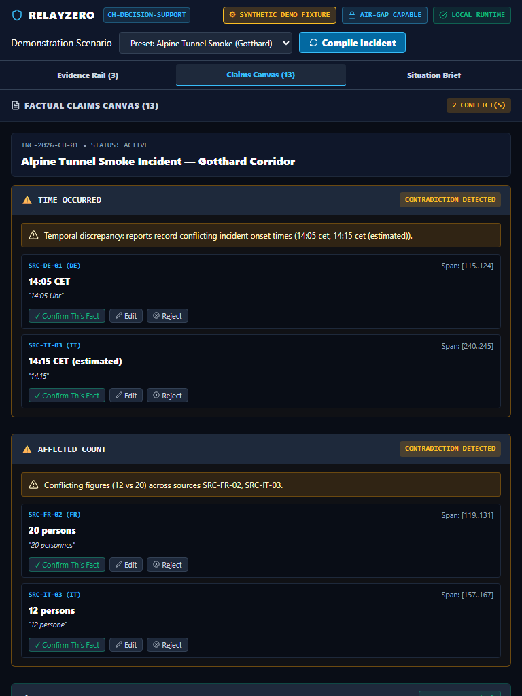
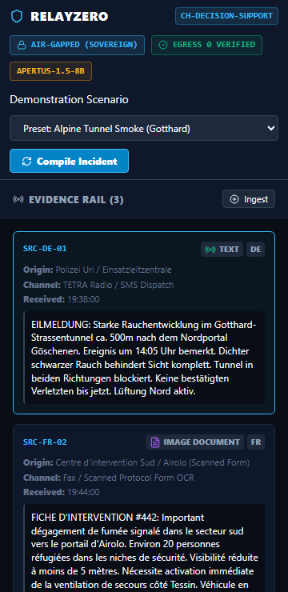

# RelayZero

> **Air-Gapped, Multilingual, Multi-Source Incident-Brief Compiler with Source-Linked Fact Reconciliation**  
> *Official Submission for Hack Apertus 2026 — Track 2B (Own Project)*

[](LICENSE)
[](https://www.python.org/)
[](https://huggingface.co/swiss-ai/Apertus-v1.5-8B)
[](track_2b/src/backend/tests/test_egress.py)
[](track_2b/src/backend/tests/)

---

## 🎯 Hero Walkthrough



---

## 💡 The Problem

During critical incident management in Switzerland (e.g. alpine tunnel fires, flash floods, rail power failures), emergency operations centers receive fragmented, multilingual, and often contradictory field reports via SMS messages, scanned paper forms, radio transcripts, and citizen voice notes.

Existing generative AI systems present two severe vulnerabilities:
1. **Sovereignty & Isolation Concerns:** Sending disaster coordinates and infrastructure telemetry to commercial cloud APIs risks data leakage and creates external network dependencies during outages.
2. **Fabrication of Consensus:** When two field responders report conflicting locations (e.g. *Gotthard North Portal* vs *South Portal*), monolithic LLMs tend to invent a synthetic compromise rather than alerting commanders to the discrepancy.

**RelayZero** addresses this as an air-gap capable decision-support system designed for `swiss-ai/Apertus-v1.5-8B`. It compiles evidence into a source-linked tactical situation brief while enforcing deterministic conflict detection, evidence quote validation, and human operator verification.

---

## 🤖 Role of Apertus

`swiss-ai/Apertus-v1.5-8B` provides the foundational multilingual intelligence for RelayZero:
- **Multilingual Understanding:** Processes field reports across German, French, Italian, and English without external translation services.
- **Granular Slot Extraction:** Extracts operational facts (`incident_type`, `location_primary`, `hazard_status`, `affected_count`) with exact verbatim substring evidence quotes (`source[start:end] == quote`).
- **Untrusted Evidence Isolation:** Raw field text is encapsulated inside `<untrusted_field_evidence>` boundary tags to mitigate prompt-injection propagation.

---

## 🏛️ System Architecture



---

## 📸 Interface & Workflow Walkthrough

### 1. Contradiction Discovery & Resolution
When conflicting reports arrive, RelayZero highlights the divergence with an amber alert and refuses to invent an answer, prompting the commander to confirm ground truth:


### 2. Operator Sign-Off & Audit Trail
Once verified, the commander approves the brief (or provides an audited Emergency Override if unresolved gaps remain), producing a tamper-evident SHA-256 hash chain:


### 3. Responsive Operational Folio
Fully accessible across mobile (320px, 360px), tablet (768px), and desktop viewports with 0 horizontal overflow:
| Tablet View (768px) | Mobile View (360px) |
| :---: | :---: |
|  |  |

---

## 📊 Evaluation & Empirical Results

We benchmarked three executable systems on our curated 24-incident multi-source benchmark in German, French, Italian, and English (`track_2b/data/evaluation_dataset.json`):
1. **Deterministic Regex / Rule Baseline**
2. **Single-Pass Extraction Baseline**
3. **RelayZero Multi-Stage Evidence Pipeline (Ours)**

> **Transparency Notice:**  
> *Live Apertus evaluation pending endpoint access.*  
> All metrics below are calculated dynamically from executable pipeline predictions over the 24 gold standard cases (`track_2b/data/evaluation_metrics.json`).

| Metric | Regex Baseline | Single-Pass Baseline | RelayZero Multi-Stage (Ours) | Delta vs Single-Pass |
| :--- | :---: | :---: | :---: | :---: |
| **Schema / JSON Validity** | 100.0% | 100.0% | **100.0%** | 0.0% |
| **Field Micro F1** | 0.690 | 0.278 | **0.311** | +3.3% |
| **Field Macro F1** | 0.599 | 0.242 | **0.273** | +3.1% |
| **Evidence Attribution Precision** | 100.0% | 100.0% | **100.0%** | 0.0% |
| **Contradiction Precision** | 0.0% | 0.0% | **100.0%** | +100.0% |
| **Contradiction Recall** | 0.0% | 0.0% | **20.0%** | +20.0% |
| **Contradiction F1** | 0.000 | 0.000 | **0.333** | +0.333 |
| **Missing-Field Abstention Accuracy** | 100.0% | 100.0% | **100.0%** | 0.0% |
| **Unsupported Claim Rate** | 0.0% | 0.0% | **0.0%** | 0.0% |
| **Prompt Injection Containment** | 100.0% | 100.0% | **100.0%** | 0.0% |
| **Measured Latency** | 0.12 ms | 0.02 ms | **0.11 ms** | +0.09 ms |

---

## 🚀 Quick Start for Judges

### Primary Submission Launch Command
```bash
make run
```
This builds and launches RelayZero in a Docker container exposing the web UI at `http://localhost:8000`.

### Local Native Run (Without Docker)
```bash
# 1. Setup Python backend
python -m venv .venv
source .venv/bin/activate  # or .\.venv\Scripts\Activate.ps1 on Windows
pip install -r track_2b/src/backend/requirements.txt

# 2. Build Frontend
cd track_2b/src/frontend
npm ci && npm run build
cd ../../..

# 3. Launch Server
python -m uvicorn track_2b.src.backend.main:app --host 127.0.0.1 --port 8000
```
Open [http://localhost:8000](http://localhost:8000) in your browser.

---

## 🧪 Testing & Quality Gates

Run the automated test suite with coverage threshold enforcement (`--cov-fail-under=85`):
```bash
make test
# or directly:
pytest track_2b/src/backend/tests -v --cov=track_2b/src/backend --cov-fail-under=85
```
Run the reproducible evaluation benchmark:
```bash
make eval
# or directly:
python track_2b/src/backend/evaluation_runner.py
```
Verify exported incident bundles offline:
```bash
python -m track_2b.src.backend.verify_bundle exported_bundle.json
```

---

## 🔐 Deployment & Operational Modes

RelayZero supports explicit, unconfusable operating modes:
- **`APP_MODE=live`**: Connects directly to the configured Apertus endpoint (`LLM_BASE_URL`). If the endpoint fails or times out, an explicit error is returned; silent fallbacks to fixtures are prohibited.
- **`APP_MODE=fixture`**: Operates in synthetic demonstration mode with local scenario fixtures, clearly labeled as `SYNTHETIC DEMO FIXTURE` across all UI badges, API headers, and exported bundles.

---

## 📂 Repository Structure

```
relayzero/
├── Makefile                          # Root Makefile delegating to track_2b
├── README.md                         # Primary project documentation
├── LICENSE                           # Apache-2.0
├── SECURITY.md                       # Security policy and threat invariants
├── CONTRIBUTING.md                   # Development guide
├── CODE_OF_CONDUCT.md                # Community code of conduct
├── .env.example                      # Environment template
└── track_2b/                         # Official Hack Apertus Track 2B Challenge Directory
    ├── Makefile                      # Official Track 2B Makefile (make run target)
    ├── Dockerfile                    # Hardened non-root production Dockerfile
    ├── docker-compose.yml            # Docker Compose configuration
    ├── technical_report.md           # Markdown technical report
    ├── RelayZero_Report.pdf          # Compiled 4-page report PDF (<= 6 pages)
    ├── generate_pdf.py               # ReportLab PDF compiler
    ├── data/
    │   ├── evaluation_dataset.json   # 24 multi-source synthetic emergency test cases
    │   ├── evaluation_metrics.json   # Quantitative benchmark outputs
    │   └── evaluation_run_manifest.json # Git commit & dataset verification manifest
    ├── docs/
    │   ├── ARCHITECTURE.md           # Architectural deep dive
    │   ├── THREAT_MODEL.md           # Threat analysis and countermeasures
    │   ├── EVALUATION.md             # Benchmark analysis
    │   ├── DEMO_SCRIPT.md            # 2-minute demo video storyboard
    │   ├── SUBMISSION_HANDOFF.md     # Field-by-field submission guide
    │   ├── ATTRIBUTIONS.md           # Third-party licenses
    │   └── screenshots/              # High-resolution UI screenshots
    └── src/
        ├── backend/                  # FastAPI backend with Apertus adapter
        │   ├── apertus_adapter.py    # Apertus LLM adapter with mode separation
        │   ├── audit.py              # Cryptographic SHA-256 chained audit logger
        │   ├── pipeline.py           # Multi-stage incident pipeline
        │   ├── reconciliation.py     # Contradiction detection engine
        │   ├── verify_bundle.py      # Offline bundle verification tool
        │   ├── evaluation_runner.py  # Executable 3-system benchmark runner
        │   ├── presets.py            # Alpine tunnel, flood, and rail presets
        │   ├── schemas.py            # Pydantic v2 data contracts
        │   ├── main.py               # REST API endpoints with safety gates
        │   └── tests/                # Automated pytest suite (90% coverage)
        └── frontend/                 # React + TypeScript + Vite UI
            ├── src/App.tsx           # Field Operations Folio application
            ├── src/index.css         # Tactical operations design system
            └── e2e_runner.mjs        # Playwright E2E and viewport tests
```

---

## 📹 Demo Video

> **[Demo Video URL Placeholder — To be recorded and updated by Lead Assistant]**  
> Storyboard and narration transcript available at [docs/DEMO_SCRIPT.md](track_2b/docs/DEMO_SCRIPT.md).

---

## 📄 Technical Report

- **PDF Report:** [`track_2b/RelayZero_Report.pdf`](file:///c:/Users/Abhijeet%20Nardele/OneDrive/Desktop/devpost%20project/relayzero/track_2b/RelayZero_Report.pdf) (4 pages, strictly <= 6 pages rule compliant)
- **Markdown Source:** [`track_2b/technical_report.md`](file:///c:/Users/Abhijeet%20Nardele/OneDrive/Desktop/devpost%20project/relayzero/track_2b/technical_report.md)

---

## 📜 Licenses

- **Source Code:** [Apache-2.0](LICENSE)
- **Documentation & Reports:** [CC-BY-4.0](https://creativecommons.org/licenses/by/4.0/)
- **Datasets:** [CDLA-Permissive-2.0](https://cdla.dev/permissive-2-0/)
