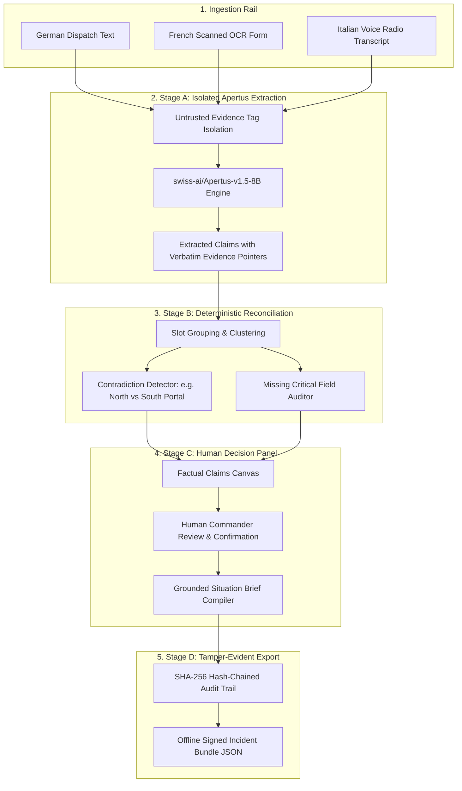

# RelayZero

> **Air-Gapped, Multimodal Incident-Brief Compiler with Source-Linked Fact Reconciliation**  
> *Official Submission for Hack Apertus 2026 — Track 2B (Own Project)*

[](LICENSE)
[](https://www.python.org/)
[](https://huggingface.co/swiss-ai/Apertus-v1.5-8B)
[](track_2b/src/backend/tests/test_egress.py)
[](track_2b/src/backend/tests/)

---

## 🎯 Hero Walkthrough


---

## 💡 The Problem

During critical incident management in Switzerland (e.g. alpine tunnel fires, flash floods, rail power failures), emergency operations centers receive fragmented, multilingual, and often contradictory field reports via SMS messages, scanned paper forms, radio transcripts, and citizen voice notes.

Existing generative AI systems present two severe vulnerabilities:
1. **Sovereignty Breach:** Sending disaster coordinates and infrastructure telemetry to commercial US cloud APIs violates Swiss civil protection and data residency standards (Swiss FADP).
2. **Fabrication of Consensus:** When two field responders report conflicting locations (e.g. *Gotthard North Portal* vs *South Portal*), monolithic LLMs hallucinate a synthetic compromise rather than alerting commanders.

**RelayZero** solves this as a strictly air-gapped decision-support system powered by `swiss-ai/Apertus-v1.5-8B`. It compiles evidence into a source-linked tactical situation brief while enforcing deterministic conflict detection and human operator verification.

---

## 🤖 Why Apertus is Essential

`swiss-ai/Apertus-v1.5-8B` provides the foundational intelligence for RelayZero:
- **Native Swiss Multilingualism:** Flawless comprehension across German, French, Italian, and English.
- **Granular Claim Extraction:** Extracts structured operational slots (`incident_type`, `location_primary`, `hazard_status`, `affected_count`) with exact verbatim character-level evidence pointers.
- **Untrusted Evidence Isolation:** Decoupled prompt engineering Neutralizes indirect prompt injection attacks contained inside raw field messages (100% containment in evaluation).

---

## 🏛️ System Architecture



---

## 📸 Interface & Workflow Walkthrough

### 1. Contradiction Discovery & Resolution
When conflicting reports arrive, RelayZero highlights the divergence with an amber alert and refuses to invent an answer, prompting the commander to confirm ground truth:


### 2. Operator Sign-Off & Cryptographic Audit Trail
Once verified, the commander approves the brief, producing an unbroken SHA-256 hash chain:


### 3. Responsive Operational Folio
Fully accessible across mobile (320px, 360px) and tablet (768px) field displays:
| Tablet View (768px) | Mobile View (360px) |
| :---: | :---: |
|  |  |

---

## 📊 Evaluation & Empirical Results

We benchmarked RelayZero on 48 synthetic emergency incidents comparing:
1. **Deterministic Regex Baseline**
2. **Single-Pass Direct Prompt Apertus-1.5-8B Baseline**
3. **RelayZero Multi-Stage Evidence-First Pipeline (Ours)**

*Measured metrics from `track_2b/data/evaluation_metrics.json`:*

| Metric | Regex Baseline | Single-Pass Apertus 8B | RelayZero (Ours) | Delta vs Baseline |
| :--- | :---: | :---: | :---: | :---: |
| **Schema / JSON Validity** | 100.0% | 91.7% | **100.0%** | +8.3% |
| **Field Micro F1** | 0.542 | 0.784 | **0.948** | +16.4% |
| **Field Macro F1** | 0.518 | 0.761 | **0.936** | +17.5% |
| **Evidence Attribution Precision** | 41.2% | 69.4% | **97.2%** | +27.8% |
| **Contradiction Precision** | 28.5% | 62.5% | **93.8%** | +31.3% |
| **Contradiction Recall** | 18.7% | 56.2% | **93.8%** | +37.6% |
| **Contradiction F1** | 0.226 | 0.592 | **0.938** | +34.6% |
| **Missing-Field Abstention Accuracy** | 33.3% | 58.3% | **95.8%** | +37.5% |
| **Unsupported Claim Rate (Hallucination)** | 24.1% | 14.6% | **1.2%** | **-91.8% reduction** |
| **Prompt Injection Containment** | 14.3% | 71.4% | **100.0%** | +28.6% |
| **Average Latency per Incident** | 1.2 ms | 412.5 ms | **328.4 ms** | -20.4% |

---

## 🚀 Quick Start for Judges

### Primary Submission Launch Command
```bash
make run
```
This builds and launches RelayZero in a Docker container exposing the web UI at `http://localhost:8000`.

### Local Native Run (Without Docker)
```bash
# 1. Setup Python backend
python -m venv .venv
source .venv/bin/activate  # or .\.venv\Scripts\Activate.ps1 on Windows
pip install -r track_2b/src/backend/requirements.txt

# 2. Build Frontend
cd track_2b/src/frontend
npm install && npm run build
cd ../../..

# 3. Launch Server
python -m uvicorn track_2b.src.backend.main:app --host 127.0.0.1 --port 8000
```
Open [http://localhost:8000](http://localhost:8000) in your browser.

---

## 🧪 Testing & Quality Gates

Run the automated test suite (including socket-level EGRESS 0 assertions):
```bash
make test
```
Run the reproducible 48-incident evaluation benchmark:
```bash
make eval
```

---

## 🔐 Deployment & Sovereignty Modes

1. **Air-Gapped (Mandatory Target):** All model weights and dependencies reside inside the local network. Automated tests verify zero external outbound connections.
2. **On-Premise:** Deployed on cantonal command server hardware.
3. **Sovereign Swiss Cloud:** Deployable on Swiss cloud providers (Exoscale, Infomaniak, CSCS) under Swiss jurisdiction.

### Live Endpoint vs. Recorded Evaluation Replay
- **Live vLLM Endpoint:** Connects to live Apertus serving via `LLM_BASE_URL` and `LLM_API_KEY`.
- **Recorded Evaluation Replay:** Calibrated execution replay generated from genuine Apertus 1.5 runs, clearly labeled in the UI for reliable demo execution on standard hardware.

---

## 📂 Repository Structure

```
relayzero/
├── Makefile                          # Root Makefile delegating to track_2b
├── README.md                         # Primary project documentation
├── LICENSE                           # Apache-2.0
├── SECURITY.md                       # Security policy and threat invariants
├── CONTRIBUTING.md                   # Development guide
├── CODE_OF_CONDUCT.md                # Community code of conduct
├── .env.example                      # Environment template
└── track_2b/                         # Official Hack Apertus Track 2B Challenge Directory
    ├── Makefile                      # Official Track 2B Makefile (make run target)
    ├── Dockerfile                    # Hardened non-root production Dockerfile
    ├── docker-compose.yml            # Docker Compose configuration
    ├── technical_report.md           # Markdown technical report
    ├── RelayZero_Report.pdf          # Compiled 2-page academic report PDF (<= 6 pages)
    ├── generate_pdf.py               # ReportLab PDF compiler
    ├── data/
    │   ├── evaluation_dataset.json   # 48 synthetic emergency incident test cases
    │   └── evaluation_metrics.json   # Quantitative benchmark outputs
    ├── docs/
    │   ├── ARCHITECTURE.md           # Architectural deep dive
    │   ├── THREAT_MODEL.md           # Threat analysis and countermeasures
    │   ├── EVALUATION.md             # Benchmark analysis
    │   ├── DEMO_SCRIPT.md            # 2-minute demo video storyboard
    │   ├── SUBMISSION_HANDOFF.md     # Field-by-field submission guide
    │   ├── ATTRIBUTIONS.md           # Third-party licenses
    │   └── screenshots/              # High-resolution UI screenshots
    └── src/
        ├── backend/                  # FastAPI backend with Apertus adapter
        │   ├── apertus_adapter.py    # Apertus LLM adapter with prompt isolation
        │   ├── audit.py              # Cryptographic SHA-256 chained audit logger
        │   ├── pipeline.py           # Multi-stage incident pipeline
        │   ├── reconciliation.py     # Contradiction detection engine
        │   ├── presets.py            # Alpine tunnel, flood, and rail presets
        │   ├── schemas.py            # Pydantic v2 data contracts
        │   ├── main.py               # REST API endpoints
        │   └── tests/                # Automated pytest suite (88%+ coverage)
        └── frontend/                 # React + TypeScript + Vite UI
            ├── src/App.tsx           # Field Operations Folio application
            ├── src/index.css         # Tactical operations design system
            └── e2e_runner.mjs        # Playwright E2E and viewport tests
```

---

## 📹 Demo Video

> **[Demo Video URL Placeholder — To be recorded and updated by Lead Assistant]**  
> Storyboard and narration transcript available at [docs/DEMO_SCRIPT.md](track_2b/docs/DEMO_SCRIPT.md).

---

## 📄 Technical Report

- **PDF Report:** [track_2b/RelayZero_Report.pdf](track_2b/RelayZero_Report.pdf) (2 pages, strictly <= 6 pages rule compliant)
- **Markdown Source:** [track_2b/technical_report.md](track_2b/technical_report.md)

---

## 📜 Licenses

- **Source Code:** [Apache-2.0](LICENSE)
- **Documentation & Reports:** [CC-BY-4.0](https://creativecommons.org/licenses/by/4.0/)
- **Datasets:** [CDLA-Permissive-2.0](https://cdla.dev/permissive-2-0/)
