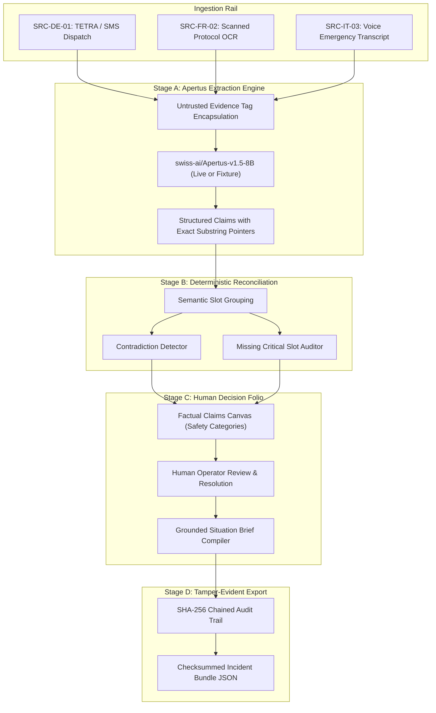

# RelayZero System Architecture & Design

RelayZero is an air-gapped, multilingual, multi-source incident-brief compiler engineered for high-consequence emergency triage operations (e.g. alpine tunnel fires, flash floods, rail power failures).

## Core Principles

1. **Air-Gap Capable & Sovereign:** Designed for completely disconnected operations with zero external network dependencies. All model weights, inference servers, databases, and client code operate inside the secure boundary.
2. **Decision-Support Boundary:** RelayZero compiles, structures, and reconciles field evidence; it *never* autonomously dispatches rescue crews, diagnoses patients, or makes safety-critical executive choices.
3. **Decoupled Architecture:** Model inference is strictly isolated to Stage A slot extraction. Cross-source contradiction detection and reconciliation are handled deterministically in Stage B.
4. **Tamper-Evident Forensics:** Every state change is recorded in an immutable, SHA-256 hash-chained audit trail.

---

## Component Diagram

---

## Pipeline Execution Stages

### Stage A: Isolated Apertus Claim Extraction
- Wraps raw multilingual reports inside `<untrusted_field_evidence>` tags to reduce prompt-injection propagation.
- Leverages `swiss-ai/Apertus-v1.5-8B` (or synthetic fixture) to extract standard operational slots: `incident_type`, `location_primary`, `location_detail`, `time_occurred`, `casualty_count`, `affected_count`, `hazard_status`, `infrastructure_impact`, `action_required`.
- Records verbatim original text and exact start/end character offsets, validating that `source[start:end] == quote`. Claims failing quote validation are rejected.

### Stage B: Deterministic Evidence Reconciliation
- Groups extracted claims by semantic field slot across reports.
- Classifies claims into distinct, honest safety categories:
  - `operator_confirmed`: Explicitly validated by human dispatcher.
  - `corroborated`: Backed by two or more independent sources with matching values.
  - `single_source_unverified`: Reported by only one source; clearly separated from confirmed facts.
  - `conflicting`: Directly contradictory claims across sources (e.g. North Portal vs South Portal).
  - `missing`: Critical operational fields with no reported evidence.
- Strictly abstains from guessing or inventing values when conflicts exist.

### Stage C: Human Decision Panel & Situation Brief
- Compiles situation briefs incorporating only `operator_confirmed` or `corroborated` claims into the "Confirmed Facts" section.
- Unresolved conflicts and missing data are surfaced as active investigation flags.
- **Approval Safety Gate:** The backend blocks brief approval whenever critical conflicts or missing fields remain, requiring an explicit, audited Emergency Override (with operator identity and mandatory operational reason).
- Supports persistent cluster-level resolutions across reconciliation updates.

### Stage D: Deterministic Offline Export
- Packages all sources, extracted claims, clusters, approved brief, and audit trail into a canonical JSON structure.
- Calculates SHA-256 bundle checksums and validates hash-chain integrity.
- Provides offline verification via `python -m track_2b.src.backend.verify_bundle bundle.json`.
