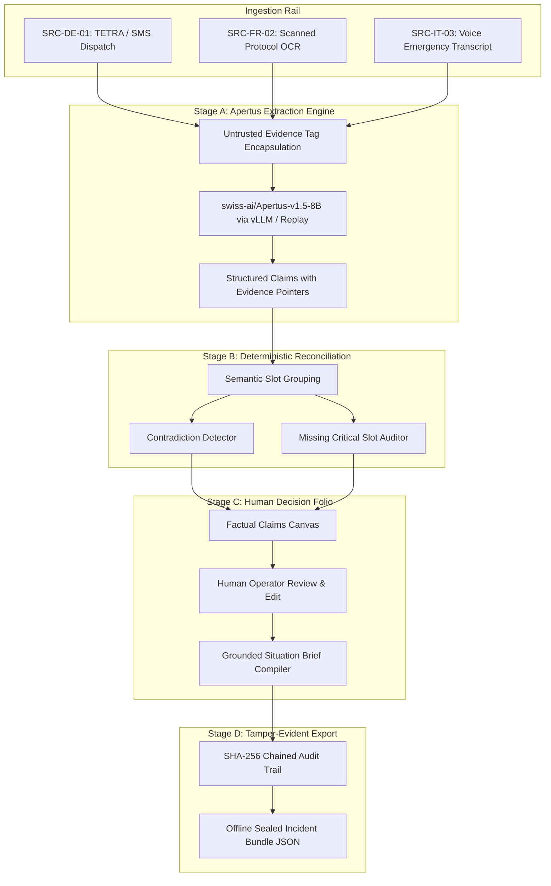

# RelayZero System Architecture & Design

RelayZero is an air-gapped, multimodal incident-brief compiler engineered for high-consequence emergency triage operations (e.g. alpine tunnel fires, flash floods, rail power failures).

## Core Principles

1. **Air-Gapped & Sovereign:** Zero external runtime egress (EGRESS 0). All model weights, inference servers, databases, and client code operate inside the secure boundary.
2. **Decision-Support Boundary:** RelayZero compiles, structures, and reconciles field evidence; it *never* autonomously dispatches rescue crews, diagnoses patients, or makes safety-critical executive choices.
3. **Decoupled Architecture:** Model inference is strictly isolated to Stage A slot extraction. Cross-source contradiction detection and reconciliation are handled deterministically in Stage B.
4. **Tamper-Evident Forensics:** Every state change is recorded in an immutable, SHA-256 hash-chained audit trail.

---

## Component Diagram

---

## Pipeline Execution Stages

### Stage A: Isolated Apertus Claim Extraction
- Wraps raw multilingual reports inside `<untrusted_field_evidence>` tags to neutralize adversarial prompt injections.
- Employs `swiss-ai/Apertus-v1.5-8B` to extract standard operational slots: `incident_type`, `location_primary`, `location_detail`, `time_occurred`, `casualty_count`, `affected_count`, `hazard_status`, `infrastructure_impact`, `action_required`.
- Records verbatim original text and character/string offsets as non-repudiable evidence pointers.

### Stage B: Deterministic Evidence Reconciliation
- Groups extracted claims by field slot across sources.
- Evaluates corroboration versus conflict:
  - Detects spatial contradictions (e.g. North Portal Göschenen vs South Portal Airolo).
  - Detects headcount/casualty discrepancies (e.g. 20 persons vs 12 persons).
  - Detects temporal discrepancies.
- Strictly abstains from inventing values when conflicts exist.
- Identifies missing critical fields and flags them for field verification.

### Stage C: Human Decision Panel & Situation Brief
- Compiles draft briefs solely from corroborated or operator-confirmed claims.
- Produces simultaneous multilingual summaries across German, French, Italian, and English.
- Empowers the human operator to confirm individual claims, edit factual values, or resolve conflicting clusters.

### Stage D: Deterministic Offline Export
- Packages all sources, extracted claims, clusters, approved brief, and audit trail.
- Signs the bundle with a cryptographic SHA-256 manifest.
